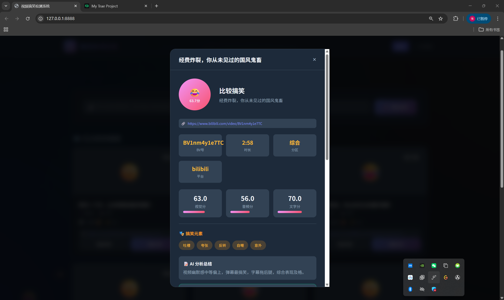
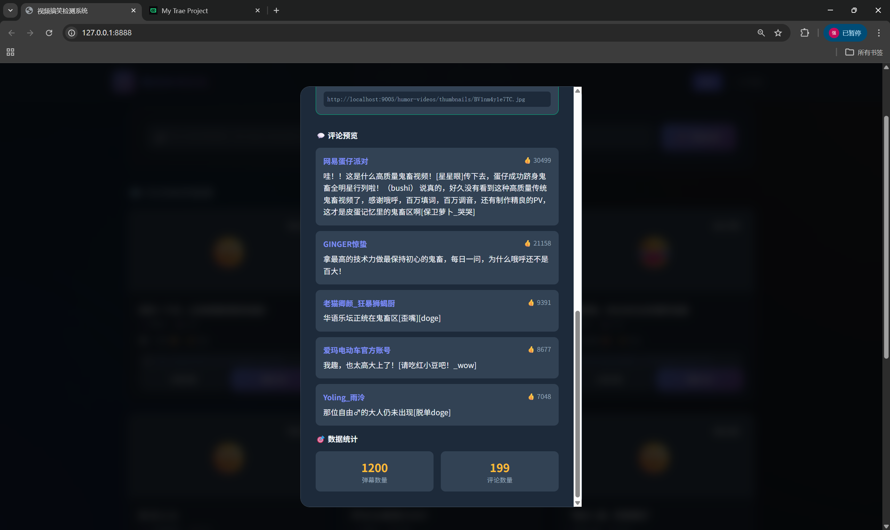

# 视频搞笑检测系统

支持 B站 视频抓取、搞笑程度 AI 分析、评论和弹幕采集的系统。

## 快速开始

### 1. 安装依赖

```bash
pip install -r requirements.txt
```

### 2. 配置

复制示例配置：

```bash
cp config/config.example.yaml config/config.yaml
```

密钥不要提交到仓库，推荐用环境变量注入（环境变量优先于配置文件）：

```bash
export DEEPSEEK_API_KEY="你的 Key"
export BILIBILI_SESSDATA="..."   # 可选，下载高清视频用
export BILIBILI_JCT="..."        # 可选
export BILIBILI_BUVID3="..."     # 可选
```

Windows PowerShell 对应写法：

```powershell
$env:DEEPSEEK_API_KEY = "你的 Key"
```

也可以只在本地的 `config/config.yaml` 中填写，该文件已被 `.gitignore` 忽略。

### 3. 运行

```bash
python main.py
```

服务将在 http://localhost:8000 启动。

## API 接口

### 健康检查

```bash
GET /health
```

### 解析视频

```bash
POST /api/v1/parse
Content-Type: application/json

{"url": "https://www.bilibili.com/video/BV1xx411c7mD"}
```

### 采集视频数据

```bash
POST /api/v1/collect/{bvid}
```

### 分析视频搞笑程度

```bash
POST /api/v1/analyze/{video_id}
```

### 获取视频列表

```bash
GET /api/v1/?page=1&page_size=20
```

### 获取视频详情

```bash
GET /api/v1/{video_id}
```

## 技术栈

- **后端**: FastAPI
- **数据库**: SQLite (可通过配置切换 PostgreSQL)
- **AI**: Deep Seek API
- **爬虫**: httpx + requests
- **视频处理**: FFmpeg

## 界面展示





